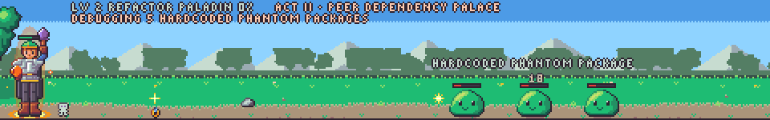
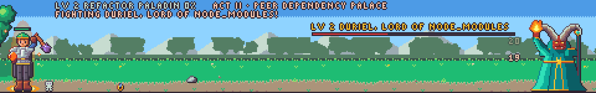
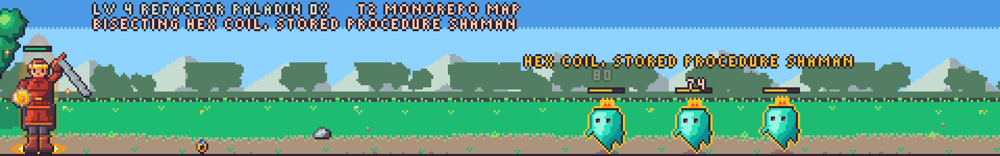
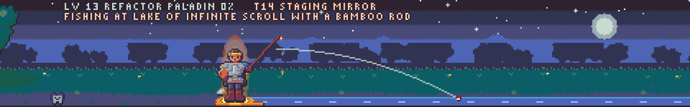
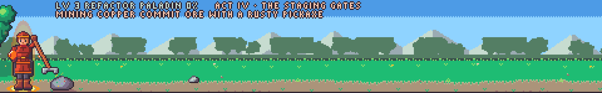
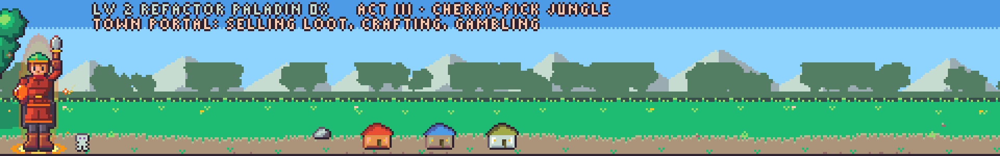
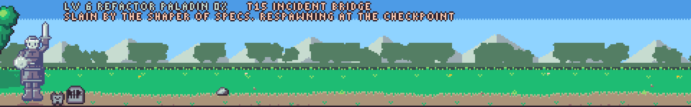

# Claude Quest

[](https://ko-fi.com/finalpantasy)

An idle ARPG mod that plays itself above your prompt in Claude Code. Your real work in Claude powers the fights; while you are away, your hero camps and fishes, mines and digs. It never calls a model, so it costs zero tokens.



*Real renders of the mod's own art, for a made-up hero. Regenerate them with `npx --no-install tsx tools/render_scenes.ts`.*

> Early access: built on Claude Code mods (function hooks), which may change between releases. Expect frequent updates.

## Install

```
/plugin marketplace add finalpantasy/claude-quest
/plugin install claude-quest@claude-quest
```

Restart Claude Code. Your hero wakes up on its own. Type `/quest` to open the character sheet.

## How it plays

- **Hands-off.** You make no choices. The hero picks its own class from how you work (after 50 actions), equips its own loot, crafts, gambles and pushes its own maps.
- **Work is fuel.** Edits, commands, reads, agents and turns bank Focus. Focus is combat time. No Focus left, the hero walks back to camp.
- **Stats follow your work.** The kind of work trains the stats: edits train Strength, reads and greps Dexterity, shell commands, agents and web calls Intelligence, turns and compactions Vitality, cache reads Luck. A quarter of all training flows to the hero's weakest stat, so nothing stays far behind. The model you use only sets the hero's race.
- **Camp life skills.** Fishing, Mining and Archaeology gather; Cooking, Smithing and Alchemy turn the haul into meals, gear quality and elixirs. Every skill also gives a small permanent combat perk.
- **A long grind.** RuneScape's XP curve with no cap: 92 is half of 99, and past 99 it keeps doubling every seven levels. Tuned for a full workday of Claude, v0.2 is a multi-year climb to 99: fast early levels, then a long road.
- **ARPG loot.** Normal to unique, set pieces, ancient and primal rolls, gems, Path of Exile style currency orbs, a Horadric Compiler for legendary powers.
- **A campaign, then forever.** Five acts, then the Atlas of Repos: map tiers without end.
- **Your habits matter.** A commit summons a treasure goblin. Green tests can light a shrine. Compacting early earns Well Rested. A daily bounty board rewards real work.

## The screen

- Above the prompt: a little animated scene (desktop app) or a one-line ticker (terminal). The hero visibly does the work it is paid in: the animation follows what you are doing in Claude.
- `/quest`: tabs for Hero, Gear, Party, Life, Log and Codex (achievements and legendary powers).
- `/quest band strip|pop|full|off` sets the size above the prompt: a one-line strip, a strip that pops to the full scene for about 10 seconds on a level up, legendary or set drop or boss kill (default), the full scene, or nothing. `/quest ticker` toggles between off and your last mode. `/quest quiet` turns toasts off.

## Gallery

| | |
|---|---|
|  |  |
| A boss at the end of a zone | A map tier in the Atlas of Repos |
|  |  |
| Fishing at camp while you are away | Mining at camp |
|  |  |
| A town visit: sell, craft, gamble | A loss: a tombstone and a ghost, then a respawn |

The one-line strip (`/quest band strip`):


## Cheap to run

Every animation is CSS inside one SVG, run by the compositor. The mod redraws only when the hero starts a new task. A save is about 12 KB. The mod also respects Claude Mod Hider: while mods are hidden, it stays out of the way above the prompt. One session at a time runs the game; the others watch.

## Where your data lives

Everything stays on your machine in `~/.claude/claude-quest/`: the hero save, a lease file, and a small counts file per session. Nothing is sent anywhere. Delete the folder to start over.

## Not affiliated

A fan-made mod. Not made, endorsed or supported by Anthropic.

## License

MIT

## Support

Free hobby project. If it helps you, you can [buy me a coffee on Ko-fi](https://ko-fi.com/finalpantasy). Thank you!
